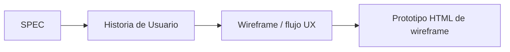
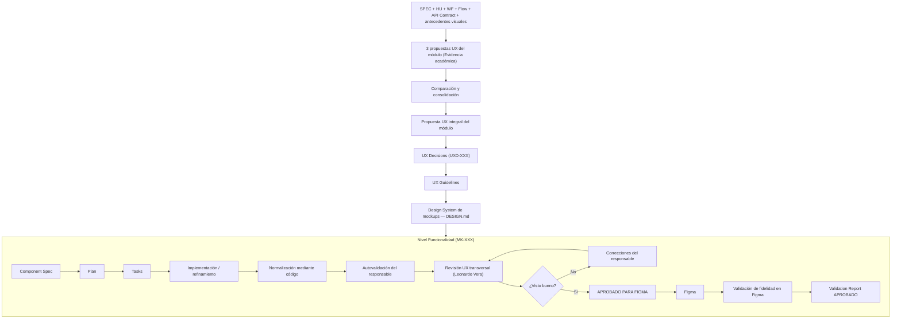
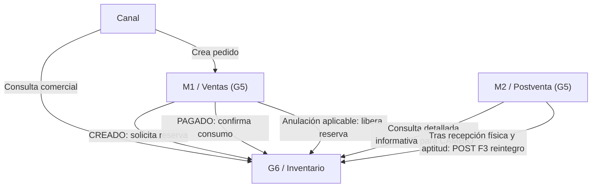
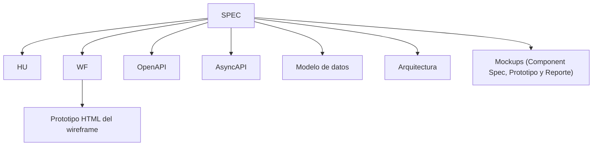
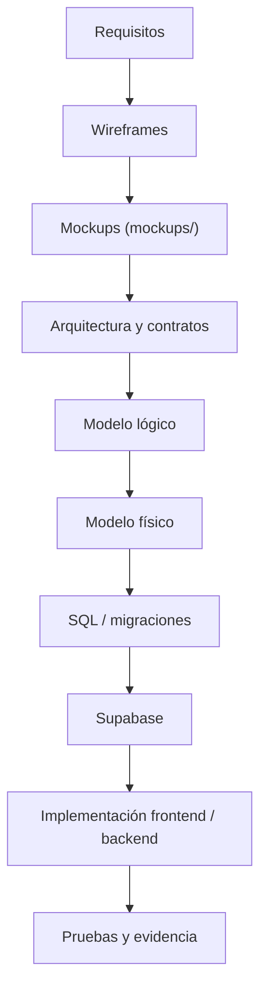

# Productos y Ofertas

API privada G6 Productos y Ofertas: [editor de Swagger Studio](https://app.swaggerhub.com/apis/sanmarcos-bb0/G6-Productos-y-Ofertas/0.6.0-rc.3) · [vista de documentación](https://app.swaggerhub.com/apis-docs/sanmarcos-bb0/G6-Productos-y-Ofertas/0.6.0-rc.3). Ambas son referencias históricas de SwaggerHub `0.6.0-rc.3`; requieren acceso autorizado y no representan la versión H5 `0.7.0-rc.1`, que aún no está publicada allí. Ver [integración, validaciones y límites de Try it out](swagger/README.md) y [hallazgos vigentes](swagger/HALLAZGOS.md). Docs conserva la fuente contractual.

Alternativa sin cuenta ni conexión a SmartBear: [Swagger UI local](swagger/LOCAL.md). Tras instalar dependencias, desde la raíz ejecuta `npm --prefix swagger run swagger:local` y abre `http://localhost:8080`. Solo consulta, con Try it out deshabilitado y escucha exclusiva en loopback.

Repositorio de documentación del módulo **Productos y Ofertas** del proyecto de Taller de Construcción de Software Web.

El módulo concentra las capacidades compartidas de catálogo, taxonomía, precios, promociones, combos, inventario y operaciones masivas que son consumidas por otros módulos del sistema, entre ellos Marketplace, Chatbot, Retail, Ventas/Postventa y Despacho.

La documentación sigue un enfoque **contract-first**: las reglas funcionales, contratos HTTP, eventos y responsabilidades de cada módulo se mantienen explícitamente separados para evitar duplicación de ownership y acoplamiento entre módulos.

---

## Hito 5 — objetivo vigente

> CI/CD incluyendo revision Seguridad — Evidencia de Pruebas de integración — Evidencia de Pruebas de performance — Uso de API Management y Mecanismo asincrónico entre Microservicios

Los cuatro criterios de aceptación y su seguimiento independiente están en [Hito 5](hitos/HITO_5.md). H4 es histórico; sus contratos se preservan bajo `contratos/historico/h4/`.

## 1. Alcance del módulo

### Seguimiento de mensajería H5

El [registro de compatibilidad Backend H5](integraciones/COMPATIBILIDAD-BACKEND-CONTRATOS-H5.md) identifica ajustes prescritos y estados sin atribuirlos como aplicados. La [matriz única de implementación Service Bus H5](integraciones/MATRIZ-IMPLEMENTACION-SERVICE-BUS-H5.md) registra relaciones, handlers, evidencia por SHA, dependencias y fases de ejecución. Los 40 mensajes y 18 pares heredados H4 son inventarios lógicos, no prueba de colas o handlers. Para tareas H5, consulta esta matriz junto con la ADR, topología y plan H5. El piloto Pricing/Price Audit es parcial y no representa una migración global.

Productos y Ofertas cubre 16 funcionalidades principales:

| ID | Funcionalidad |
|---|---|
| 001 | Carga y exportación masiva de productos |
| 002 | Gestión de combos de productos |
| 003 | Gestión de productos |
| 004 | Gestión de variantes y SKU |
| 005 | Gestión de cupones de descuento |
| 006 | Gestión de ofertas y promociones |
| 007 | Reglas de venta cruzada y upselling |
| 008 | Gestión de categorías y subcategorías |
| 009 | Gestión de características y valores |
| 010 | Asociación entre tipos de producto y características |
| 011 | Gestión de marcas |
| 012 | Gestión de SEO y metadatos |
| 013 | Gestión de precios individuales y masivos |
| 014 | Historial y auditoría de precios |
| 015 | Control de stock y disponibilidad |
| 016 | Dashboard analítico y alertas de stock |

### 1.1. Cadenas de evolución documental

Cada funcionalidad se mantiene mediante dos cadenas coordinadas: una funcional/UX (con etapas de baja y alta fidelidad) y otra contractual/técnica.

#### Baja fidelidad (Wireframes):

El prototipo HTML valida el comportamiento y la representación estructural del wireframe; **no es la fuente del contrato API**.

#### Alta fidelidad (Mockups definitivos):


El inventario detallado de funcionalidades, responsables y artefactos canónicos se encuentra en [`wireframes/INDEX.md`](ux/wireframes/INDEX.md) y en [`mockups/README.md`](ux/mockups/README.md).

---

## 2. Cómo navegar este repositorio

| Artefacto | Ubicación | Propósito |
|---|---|---|
| Especificaciones funcionales | [`specs/`](requisitos/specs) | Reglas de negocio y comportamiento esperado |
| Historias de usuario | [`hu/`](requisitos/hu) | Necesidades del usuario y criterios funcionales |
| Flujos funcionales complementarios | [`flujos/`](requisitos/flujos) | Flujos detallados de procesos relevantes |
| Wireframes (Baja fidelidad) | [`wireframes/flows/`](ux/wireframes/flows) | Definición funcional y estructural de interfaces |
| Prototipos HTML de wireframe | [`wireframes/prototipos/`](ux/wireframes/prototipos) | Representaciones navegables de los wireframes |
| Guía visual de wireframes | [`wireframes/DESIGN.md`](ux/wireframes/DESIGN.md) | Lineamientos visuales aplicables exclusivamente a wireframes |
| Índice funcional canónico | [`wireframes/INDEX.md`](ux/wireframes/INDEX.md) | Mapeo de las 16 funcionalidades y responsables |
| Visor de prototipos | [`wireframes/Visor_Prototipos_PO.html`](ux/wireframes/Visor_Prototipos_PO.html) | Acceso unificado a prototipos de wireframes |
| Pipeline de Mockups (Alta fidelidad) | [`mockups/`](ux/mockups) | UX transversal, decisiones, plantillas y código de prototipado |
| Arquitectura | [`Arquitectura.md`](arquitectura/Arquitectura.md) | Diseño técnico y decisiones arquitectónicas |
| Modelo conceptual | [`Modelo_Conceptual.md`](arquitectura/Modelo_Conceptual.md) | Ownership y relaciones conceptuales de datos |
| Contrato de integración | [`Contrato_Api.md`](contratos/http/Contrato_Api.md) | Responsabilidades e integración con otros módulos |
| OpenAPI | [`contratos/http/openapi.yaml`](contratos/http/openapi.yaml) | Contrato HTTP ejecutable |
| AsyncAPI H5 canónico | [`contratos/eventos/asyncapi.yaml`](contratos/eventos/asyncapi.yaml) | Contrato `0.7.0-rc.1`, `SEMIFINAL_G6` |
| Catálogo de errores | [`contratos/http/catalogo-errores.md`](contratos/http/catalogo-errores.md) | Semántica estable de errores del módulo |
| Catálogo de eventos | [`contratos/eventos/catalogo-eventos.md`](contratos/eventos/catalogo-eventos.md) | Eventos publicados y consumidos |
| Arquitectura objetivo H5 | [`arquitectura/decisiones/ADR-H5-SERVICE-BUS-BASIC.md`](arquitectura/decisiones/ADR-H5-SERVICE-BUS-BASIC.md) | Azure Service Bus Basic interno G6, adoptado; piloto aislado #234 validado; implementación compartida y verificaciones globales pendientes |
| Topología y operación H5 | [`contratos/eventos/TOPOLOGIA-SERVICE-BUS-BASIC-H5.md`](contratos/eventos/TOPOLOGIA-SERVICE-BUS-BASIC-H5.md), [`arquitectura/operacion-service-bus-basic-h5.md`](arquitectura/operacion-service-bus-basic-h5.md) | Arquitectura adoptada; piloto aislado Pricing → Price Audit validado en Azure según #234; recursos y activación compartidos pendientes de verificar |

| Inventario y frontera H5 | [`contratos/eventos/INVENTARIO-40-MENSAJES-H5.md`](contratos/eventos/INVENTARIO-40-MENSAJES-H5.md), [`integraciones/MATRIZ-EXTERNOS-ASYNCAPI-H5.md`](integraciones/MATRIZ-EXTERNOS-ASYNCAPI-H5.md) | 40 mensajes H4, 13 asignaciones a G5, 18 pares internos H4; transición externa HTTP bajo hipótesis G5 de planificación |
| Baseline HTTP H5 y propuesta G5–G6 | [`contratos/http/PROPUESTA-OPERACIONES-CUPONES-H5.md`](contratos/http/PROPUESTA-OPERACIONES-CUPONES-H5.md), [`integraciones/REFERENCIA-G5-G6-H5-REVISION-01.md`](integraciones/REFERENCIA-G5-G6-H5-REVISION-01.md) | Cuatro rutas externas incluidas en OpenAPI `0.7.0-rc.1` `SEMIFINAL_G6`; hipótesis de aceptación G5 solo para planificación, homologación formal y grants G7 pendientes |
| Plan H5 y gates | [`integraciones/PLAN-MIGRACION-MENSAJERIA-H5.md`](integraciones/PLAN-MIGRACION-MENSAJERIA-H5.md), [`tests/contratos/PLAN-VERIFICACION-SERVICE-BUS-H5.md`](tests/contratos/PLAN-VERIFICACION-SERVICE-BUS-H5.md) | Migración, verificación y bloqueos separados por estado |
| Índice de transición H4→H5 | [`integraciones/INDICE-TRANSICION-MENSAJERIA-H4-H5.md`](integraciones/INDICE-TRANSICION-MENSAJERIA-H4-H5.md) | Clasifica contrato H4, compatibilidad transitoria, legado y menciones funcionales |
| Procedimientos RabbitMQ H4 | [`arquitectura/operacion-rabbitmq.md`](arquitectura/operacion-rabbitmq.md), [`ops/rabbitmq/`](ops/rabbitmq/), [`tests/rabbitmq-aislamiento/README.md`](tests/rabbitmq-aislamiento/README.md) | `LEGADO_H4`; consulta histórica/compatibilidad del runtime anterior, no guía de implementación H5 |
| Contrato AsyncAPI H4 | [`contratos/historico/h4/eventos/asyncapi.yaml`](contratos/historico/h4/eventos/asyncapi.yaml) | Snapshot histórico; bindings y topología física no autorizan implementación H5 |
| Kit de integración | [`contratos/http/kit-integracion.md`](contratos/http/kit-integracion.md) | Guía práctica de integración para otros módulos |
| Matriz de pruebas de contrato | [`contratos/pruebas/pruebas-contrato.md`](contratos/pruebas/pruebas-contrato.md) | Casos estáticos, provider, consumer/provider, seguridad e integración |
| Acuerdos de integración | [`integraciones/`](integraciones/) | Documentación de alineaciones, acuerdos publicados y pendientes de homologación con otros módulos; los acuerdos G3–G6 A16/A17 están aceptados documentalmente en [ALINEACION_CHATBOT.md](integraciones/ALINEACION_CHATBOT.md). |
| Consolidación G5–G6 Hito 4 | [`integraciones/ACUERDO_G5_G6_H4_2026-10-21.md`](integraciones/ACUERDO_G5_G6_H4_2026-10-21.md) | Decisiones D-01 a D-04, Postventa y estados de aceptación/implementación separados |
| Equipo y responsabilidades | [`EQUIPO_Y_RESPONSABILIDADES.md`](EQUIPO_Y_RESPONSABILIDADES.md) | Roles transversales, ownership funcional y mecanismos de revisión del equipo |
| Instrucciones para agentes | [`AGENTS.md`](AGENTS.md) | Orden de lectura, límites de cambios y validaciones mínimas |
| Registro DEC-F | [`arquitectura/decisiones/REGISTRO_DEC_F.md`](arquitectura/decisiones/REGISTRO_DEC_F.md) | DEC-F-001 a DEC-F-015 adoptadas internamente; homologación de contratos pendiente |
| Acuerdos internos G6 H4 (2026-11-01) | [`arquitectura/decisiones/ACUERDOS-INTEGRACION-INTERNA-G6-H4.md`](arquitectura/decisiones/ACUERDOS-INTEGRACION-INTERNA-G6-H4.md) | DEC-G6-INT-01 a 13; acuerdos internos complementarios, no homologación ni evidencia de implementación |
| Matriz de trazabilidad DEC-F | [`arquitectura/decisiones/MATRIZ_TRAZABILIDAD_DEC_F.md`](arquitectura/decisiones/MATRIZ_TRAZABILIDAD_DEC_F.md) | Referencias, estados, contradicciones y validación pendiente |
| Propuestas DEC-F backend (histórico) | [`arquitectura/decisiones/PROPUESTAS_DEC_F_BACKEND.md`](arquitectura/decisiones/PROPUESTAS_DEC_F_BACKEND.md) | Evidencia histórica; el registro es la fuente normativa vigente |
| Matriz intermodular backend | [`integraciones/MATRIZ_INTERMODULAR_BACKEND.md`](integraciones/MATRIZ_INTERMODULAR_BACKEND.md) | Estado de integración, homologación y bloqueos por módulo |
| Política de seguridad progresiva G6 | [`arquitectura/decisiones/POLITICA-SEGURIDAD-PROGRESIVA-G6.md`](arquitectura/decisiones/POLITICA-SEGURIDAD-PROGRESIVA-G6.md) | Decisión adoptada y publicada en Docs PR #114, fusionado el 2026-11-05; implementación y despliegue se evidencian por separado |
| Matriz de operaciones de seguridad | [`arquitectura/decisiones/MATRIZ-OPERACIONES-SEGURIDAD-G6.md`](arquitectura/decisiones/MATRIZ-OPERACIONES-SEGURIDAD-G6.md) | Inventario OpenAPI por ocho servicios; lectura pública candidata o pendiente, no grant |
| Persistencia por bounded context | [`bd/`](datos) | Modelo físico, migraciones y scripts de validación SQL por servicio |

---

## 3. Fuentes de verdad

No todos los documentos tienen la misma autoridad.

| Tema | Fuente de verdad |
|---|---|
| Reglas funcionales | `requisitos/specs/SPEC-XXX-*.md` |
| Necesidad y comportamiento desde usuario | `requisitos/hu/HU-XXX-*.md` |
| Comportamiento de interfaz (Baja fidelidad) | `wireframes/flows/WF-XXX-*.md` |
| Representación visual de wireframes | `wireframes/DESIGN.md` |
| UX transversal y decisiones de mockups | `mockups/ux/propuesta-ux.md` y `mockups/ux/ux-decisions.md` |
| Reglas operativas de mockups | `mockups/ux/ux-guidelines.md` |
| Contrato HTTP | `contratos/http/openapi.yaml` |
| Contrato funcional de eventos H4 | `contratos/historico/h4/eventos/asyncapi.yaml` (snapshot histórico; véase índice H4→H5) |
| Arquitectura objetivo de mensajería H5 | ADR H5 + topología Service Bus Basic |
| Códigos de error | `contratos/http/catalogo-errores.md` |
| Eventos | `contratos/eventos/catalogo-eventos.md` |
| Ownership e integración entre módulos | `Contrato_Api.md` |
| Arquitectura interna | `Arquitectura.md` |
| Ownership conceptual de datos | `Modelo_Conceptual.md` |

Ante una diferencia entre documentación narrativa y un contrato ejecutable, se debe revisar primero la fuente de verdad correspondiente y posteriormente propagar la corrección a los documentos derivados.

> **Nota sobre diseño:** `wireframes/DESIGN.md` gobierna únicamente la representación visual de baja fidelidad de los wireframes históricos. Los mockups de alta fidelidad se rigen exclusivamente por la Propuesta UX Integral del módulo, las UX Decisions, las UX Guidelines y el Design System correspondiente bajo [`mockups/`](ux/mockups).

---

## 4. Arquitectura

### Mensajería H5 — decisión vigente

G6 adoptó Azure Service Bus Basic exclusivamente para comunicación asíncrona interna entre sus bounded contexts. Las integraciones externas son HTTP autenticado por APIM/Gateway; no se exponen credenciales ni acceso directo al broker. El broker del runtime H4 permanece sujeto a su compatibilidad transitoria. La adopción arquitectónica no equivale a migración global. El piloto aislado Pricing → Price Audit cuenta con pruebas Azure reales según [Backend #234](https://github.com/Taller-SW-Web/G6-Productos-Ofertas-backend/issues/234); esto no acredita vigencia de sus recursos, release de aplicaciones compartidas, infraestructura compartida, migración global, autorización G7 ni homologación G5. Para la frontera G5–G6 H5, la aceptación se asume solo para planificación conforme a [`G5-G6-H5-REVISION-01`](integraciones/REFERENCIA-G5-G6-H5-REVISION-01.md); homologación bilateral efectiva, grants G7, implementación, E2E y despliegue se acreditan por separado.

Para mensajería H5 consultar primero la [ADR](arquitectura/decisiones/ADR-H5-SERVICE-BUS-BASIC.md), la [topología](contratos/eventos/TOPOLOGIA-SERVICE-BUS-BASIC-H5.md) y el [plan de migración](integraciones/PLAN-MIGRACION-MENSAJERIA-H5.md). El AsyncAPI H4 se conserva por sus semánticas funcionales; no se derivan de él infraestructura, colas o bindings H5. Véase el [índice de transición](integraciones/INDICE-TRANSICION-MENSAJERIA-H4-H5.md).


El módulo se divide en ocho bounded contexts de negocio.

| Servicio | Responsabilidad |
|---|---|
| `taxonomy-svc` | Categorías, marcas, características, valores, tipos de producto y asociaciones |
| `catalog-svc` | Productos, variantes, SKU, imágenes, atributos y perfil físico |
| `pricing-svc` | Precios, vigencias, canales y programación |
| `price-audit-svc` | Historial y auditoría de cambios de precio |
| `promotions-svc` | Promociones, cupones, cross-sell y upselling |
| `combos-svc` | Definición y composición de combos |
| `inventory-svc` | Saldos, reservas, consumo, liberación, expiración, ajustes, incidencias y cuarentenas, reintegros, conciliación offline, traslados y recepciones, Kardex, disponibilidad y dashboard |
| `bulk-svc` | Importación, exportación y procesamiento masivo |

Adicionalmente existe un `api-gateway` / BFF como punto de acceso, pero no constituye un bounded context de negocio.

La descripción completa, reglas de dependencias, persistencia, mensajería, resiliencia, seguridad, observabilidad y diagramas C4 se encuentran en [`Arquitectura.md`](arquitectura/Arquitectura.md).

---

## 5. Ownership de negocio

El sistema evita compartir directamente bases de datos o entidades entre módulos.

| Información / proceso | Módulo propietario |
|---|---|
| Producto, variante y SKU | Productos y Ofertas |
| Categoría, marca y características | Productos y Ofertas |
| Precio | Productos y Ofertas |
| Promoción y cupón | Productos y Ofertas |
| Combo | Productos y Ofertas |
| Stock y reservas | Productos y Ofertas |
| Usuario, identidad, roles y autenticación | Seguridad y Usuarios |
| Pedido, pago y estado comercial | M1/Ventas (G5) |
| Devoluciones, cambios y resolución de reembolsos | M2/Postventa (G5) |
| Despacho, empaque y entrega | Despacho y Entrega |

No se permiten foreign keys ni consultas SQL directas entre bases de datos pertenecientes a módulos diferentes.

La integración se realiza mediante contratos HTTP y mensajería asíncrona publicada.

---

## 6. Integración con Ventas/Postventa

El flujo documentado para los canales web es:



G6 mantiene el saldo autoritativo y valida y registra los reintegros con Kardex, idempotencia y Outbox.

M1/Ventas es owner del pedido y el pago; solicita la reserva cuando corresponde, confirma el consumo tras el pago y libera reservas en los estados aplicables. Para CAMBIO, M1 crea una orden propia de reemplazo sin cobro, vinculada por G5 al pedido original; administra nueva reserva, consumo al sellar el paquete y espera el resultado definitivo confirmado antes de solicitar despacho (`202` solo admite el comando). M1 libera antes del consumo. El TTL de reserva no se renueva; si vence o se rechaza, M1 anula y, si procede, crea otra orden y reserva. M2/Postventa recibe e inspecciona físicamente en Lurín, usa el SKU original y luego invoca F3; consulta disponibilidad detallada solo de forma informativa. M1 y M2 usan scopes de Inventario diferenciados. Para crear la orden de reemplazo, G5 documenta `POST /api/v1/pedidos/reemplazos` con scope `ventas:pedidos:reemplazar` para `modulo-postventa`; G5 lo propuso y G7 aún debe registrarlo y conceder el grant efectivo. No se atribuye concesión. G6 conserva la autoridad del stock y registra cada reintegro. Estos acuerdos documentales no acreditan implementación ni pruebas runtime.

Para H4, `commercial_snapshot_ref = order_id`, donde `order_id` es el `pedidoId` textual G5. G6 no acredita verificación independiente de todas las condiciones comerciales y las campañas no verificables permanecen deshabilitadas. La topología física existente usa vhost `g6-productos-ofertas`, exchanges `po.comandos.x`, `po.eventos.x`, `po.resultados.x`, colas `po.ventas.q`, `po.inventario.q`, `po.promociones.q` y túnel SSH local G5 `127.0.0.1:5673`. G6 adopta internamente nombres españoles rc.3; adaptación/homologación operativa G5 pendiente. Render y Retail offline siguen pendientes por separado; grants G7, productor real de rechazos/expiración, Retry/DLX y E2E no se acreditan.

Marketplace y Chatbot consultan disponibilidad comercial. La conciliación de ventas offline de Retail sigue pendiente de homologación: G4/G5/G6 documentan invocadores, rutas e identidades incompatibles, y OpenAPI G6 solo permite actualmente `modulo-ventas`. La lógica interna de conciliación ya definida (stock autoritativo, aplicación parcial sin saldo negativo, Kardex e idempotencia) puede implementarse en G6; el invocador, mapeo, request/response compatible, grant G7 y secuencia intermodular requieren acuerdo. Retail puede reportar y resolver incidencias físicas mediante sus capacidades autorizadas.

G5 es el owner externo general de los procesos de Ventas y Postventa; M1/Ventas conserva el pedido/pago y M2/Postventa las devoluciones/cambios. Productos y Ofertas mantiene el estado autoritativo del inventario.

Las reservas pueden expirar mediante un TTL configurable.

---

## 7. Integración con Despacho

Productos y Ofertas es propietario de las propiedades físicas intrínsecas de cada SKU, como peso y dimensiones.

Despacho y Entrega es propietario de las decisiones logísticas derivadas de esos datos, entre ellas:

- Tipo de empaque.
- Agrupación de unidades.
- Cantidad de paquetes.
- Volumen logístico final.
- Capacidad de transporte.

El módulo de Productos y Ofertas no incorpora reglas propias de empaquetado.

---

## 8. Contratos de API

La API HTTP utiliza como prefijo:

```text
/api/v1
```

Los recursos se organizan por dominio y se publican en español.

Ejemplos:

```text
/api/v1/productos
/api/v1/categorias
/api/v1/marcas
/api/v1/precios
/api/v1/promociones
/api/v1/cupones
/api/v1/combos
/api/v1/inventario
```

El contrato HTTP completo se encuentra en:

[`contratos/http/openapi.yaml`](contratos/http/openapi.yaml)

La mensajería asíncrona se encuentra en:

[`contratos/eventos/asyncapi.yaml`](contratos/eventos/asyncapi.yaml)

La explicación humana de responsabilidades e integración se mantiene en:

[`Contrato_Api.md`](contratos/http/Contrato_Api.md)

### Versiones contractuales actuales

| Artefacto | Versión |
|---|---|
| OpenAPI 3.1.0 | `0.7.0-rc.1`, baseline semifinal H5 G6; 148 operaciones (143 H4 preservadas y 5 nuevas); pendiente de homologación externa e implementación/validación independientes |
| AsyncAPI 3.0.0 | `0.7.0-rc.1`, baseline semifinal H5; 19 canales y 29 tipos de mensaje para Service Bus Basic interno; H4 íntegro en snapshots históricos |
| Línea base histórica OpenAPI/AsyncAPI | `0.5.0` (compatibilidad; no sustituida automáticamente en runtime) |
| Catálogo de errores | Vocabulario humano alineado con OpenAPI H5 `0.7.0-rc.1` semifinal |
| Catálogo de eventos | 40 mensajes históricos H4; AsyncAPI canónico H5 define 29 tipos, aún sin evidencia de publicación real |
| Topología RabbitMQ H4 | Contrato histórico; no inferir aprovisionamiento actual ni usar como topología H5 |
| Kit de integración | Guía documental derivada del contrato candidato |

**Estado de publicación:** OpenAPI y AsyncAPI canónicos `0.7.0-rc.1` son `SEMIFINAL_G6`; la versión H4 se conserva byte por byte en `contratos/historico/h4/` con hashes en `SHA256SUMS`. Las interfaces compartidas siguen pendientes de homologación externa. Esto no acredita implementación, runtime, CI/CD, pruebas de integración/performance, grants, APIM habilitado, recursos Azure compartidos ni despliegue. La homologación G2 H4 documentada permanece histórica y no implica aceptación de la baseline H5.

---

## 9. Diseño y experiencia de usuario

El módulo cuenta con dos niveles de diseño formalmente articulados:

### 9.1. Baja fidelidad (Wireframes)
Las 16 funcionalidades disponen de definición de wireframe funcional y prototipo HTML navegable gobernados por:

[`wireframes/DESIGN.md`](ux/wireframes/DESIGN.md)

Este documento define exclusivamente los lineamientos de los **wireframes de baja fidelidad**. Los prototipos HTML correspondientes son artefactos estáticos de documentación y validación estructural; no constituyen el frontend productivo.

Para recorrer los wireframes desde un único punto puede utilizarse:
[`wireframes/Visor_Prototipos_PO.html`](ux/wireframes/Visor_Prototipos_PO.html)

### 9.2. Alta fidelidad (Pipeline de Mockups)
La evolución hacia mockups de alta fidelidad se rige de forma estricta por la gobernanza transversal del módulo documentada en:

[`mockups/`](ux/mockups)

Este pipeline no mezcla las reglas visuales de los wireframes con las decisiones de alta fidelidad. Se fundamenta en:
- [`mockups/ux/propuesta-ux.md`](ux/mockups/ux/propuesta-ux.md): Las 3 propuestas UX finales de #59, matriz de las 16 funcionalidades, evaluación de los borradores y Propuesta UX Integral Adoptada para el Gestor Comercial.
- [`mockups/ux/ux-decisions.md`](ux/mockups/ux/ux-decisions.md): Decisiones transversales justificadas (`UXD-001` a `UXD-012`).
- [`mockups/ux/ux-guidelines.md`](ux/mockups/ux/ux-guidelines.md): Reglas normativas operativas y accesibilidad en PC Desktop (viewport canónico de 1440 px).
- [`mockups/DESIGN.md`](ux/mockups/DESIGN.md): Design System vigente de mockups, con foundations, layout desktop, componentes y estados visuales alineados con la UX transversal.
- [`mockups/prototipo/`](ux/mockups/prototipo): Código interactivo normalizado de prototipado (bajo `src/pantallas/MKXXX`).

La cadena completa de diseño de alta fidelidad es:


---

## 10. Ownership funcional

| Rama | Responsable | Área principal |
|---|---|---|
| `castilla` | Marco Renato Castilla Huanca | Carga/exportación masiva y combos |
| `poma` | Gabriel Poma Gutierrez | Productos y variantes SKU |
| `cueva` | Axel Andree Cueva Alcalá | Cupones, promociones y venta cruzada |
| `lopez` | Leonardo Lopez | Taxonomía, características, marcas y SEO |
| `vera` | Leonardo Vera Rodríguez | Precios y auditoría de precios |
| `taco` | Miguel Ángel Taco Zavala | Inventario, analítica y alertas |

La asignación detallada de cada una de las 16 funcionalidades se mantiene en [`wireframes/INDEX.md`](ux/wireframes/INDEX.md) y [`mockups/README.md`](ux/mockups/README.md).

Los roles transversales, los límites de responsabilidad y los mecanismos de revisión del equipo se documentan en [`EQUIPO_Y_RESPONSABILIDADES.md`](EQUIPO_Y_RESPONSABILIDADES.md).

---

## 11. Estado documental

| Área | Estado |
|---|---|
| 16 especificaciones funcionales | Consolidado |
| 16 historias de usuario | Consolidado |
| 16 wireframes funcionales | Consolidado |
| 16 prototipos HTML de wireframes | Consolidado |
| Guía visual de wireframes (`wireframes/DESIGN.md`) | Consolidado |
| Pipeline de mockups y gobernanza UX transversal (`mockups/`) | Aprobado y en ejecución |
| Arquitectura | Consolidado |
| Modelo conceptual | Consolidado |
| Contrato de integración | Consolidado |
| OpenAPI | Disponible |
| AsyncAPI | Disponible |
| Catálogo de errores | Disponible |
| Catálogo de eventos | Disponible |
| Modelo lógico/físico de BD | Implementado para `inventory-svc` (en evolución para el resto) |
| Implementación de BD / Supabase | Validación local OK para `inventory-svc`; despliegue Supabase pendiente (Hito 2) |
| Matriz de trazabilidad integral | Pendiente de consolidación |

---

## 12. Regla de mantenimiento documental

Cuando una funcionalidad cambie, la modificación no debe limitarse a un único archivo.

Debe revisarse la cadena completa:



Solo deben modificarse los artefactos afectados por el cambio, pero todos deben ser revisados para verificar consistencia.

Los contratos ejecutables no deben duplicarse manualmente dentro de otros documentos.

---

## 13. Principios del repositorio

Este repositorio busca mantener:

- Una única fuente de verdad para cada tipo de información.
- Trazabilidad entre requisitos, experiencia de usuario, arquitectura y contratos.
- Separación de ownership entre módulos.
- Contratos independientes de la implementación.
- Documentación navegable y auditable.
- Evidencia clara de responsabilidad por funcionalidad.
- Compatibilidad entre especificaciones, APIs, eventos y modelos de datos.
- Evolución controlada de los contratos.

---

## 14. Próxima evolución documental

### Decisión H5 adoptada: Azure Service Bus Basic

H4 conserva RabbitMQ como arquitectura histórica en snapshots y fixtures; H5 canónico usa Service Bus Basic interno y fronteras externas HTTP autenticadas. G6 adoptó Azure Service Bus Basic exclusivamente para flujos internos H5. Los consumidores externos G1–G5 acceden a G6 por HTTP autenticado; G7 conserva la autoridad de identidad y grants. Para las 13 asignaciones históricas de `modulo-ventas`, la aceptación de la propuesta G5–G6 se asume solo para planificación; homologación bilateral efectiva y autorización G7 siguen pendientes. Decisión interna, homologación, grants, implementación, pruebas y despliegue son estados separados; ninguno se presume alcanzado por estos documentos.

Basic no ofrece topics, sessions, detección de duplicados administrada ni `DefaultMessageTimeToLive`; el máximo de 256 KB incluye propiedades. La expiración comercial de reservas depende del estado y `expires_at` autoritativo de Inventario, no del TTL del broker. Véanse la [ADR adoptada](arquitectura/decisiones/ADR-H5-SERVICE-BUS-BASIC.md), la [topología H5](contratos/eventos/TOPOLOGIA-SERVICE-BUS-BASIC-H5.md) y el [plan de migración](integraciones/PLAN-MIGRACION-MENSAJERIA-H5.md).

Los siguientes artefactos ampliarán la trazabilidad hacia el Hito 2:

- Implementación incremental y validación de los 16 mockups (`mockups/MK-001` a `MK-016`).
- Modelo lógico de base de datos (resto de bounded contexts; `inventory-svc` ya cuenta con [`bd/inventory-svc/physical-model.md`](datos/inventory-svc/physical-model.md)).
- Modelo físico de base de datos (`inventory-svc` implementado en `migration.sql`).
- Scripts SQL y migraciones (`inventory-svc` validado localmente con `validation.sql`).
- Evidencia de implementación en Supabase (despliegue del schema `inventory`, coordinado con Axel Cueva).
- Matriz integral de trazabilidad.
- Evidencia de pruebas y validación funcional.

La evolución esperada de la documentación será:



El objetivo es mantener una cadena verificable desde la necesidad funcional hasta la implementación técnica.

---

<!-- HOMOLOGACION-HTTP-0.5.0:START -->
## Homologación HTTP 0.5.0

La homologación `0.5.0` queda como antecedente histórico. En el PR #86, los contratos ejecutables **candidatos** OpenAPI/AsyncAPI tienen versión `0.6.0-rc.1` (40 canales y mensajes en AsyncAPI). Su vigencia en producción no se presupone.

Nuevos acuerdos locales:

```text
integraciones/ALINEACION_MARKETPLACE.md
integraciones/ALINEACION_RETAIL.md
```

`modulo-ventas` y `modulo-postventa` pueden consultar `GET /api/v1/inventario/disponibilidad`, sujetos al scope `inventario:disponibilidad:leer` y a su allowlist. M2 usa esa información para CAMBIO de forma informativa y no reserva stock. Marketplace, Chatbot y Retail solo consultan endpoints comerciales, que no exponen saldos ni ubicaciones internas. Los usuarios humanos autorizados conservan una vía de seguridad distinta mediante `userBearer`. `inventario:operaciones:leer` sigue siendo exclusivo de M1/Ventas y pendiente de concesión por G7; la documentación no acredita grants reales. La matriz de pruebas inter-módulo se encuentra en `contratos/pruebas/pruebas-contrato.md`.

**D-INV-01 está adoptada**: una sola ubicación elegible por referencia de cumplimiento; no sumar saldos independientes. Mapeo ausente/ambiguo o cumplimiento no demostrable: `INDETERMINADO`. El GET comercial y el POST de verificación por cantidad son consultas sin efectos; el POST devuelve `binding=false` y no reserva. Las rutas siguen `provisional` por implementación/pruebas pendientes. **D-REC-01/02** continúan abiertas y son decisiones distintas.
<!-- HOMOLOGACION-HTTP-0.5.0:END -->

## Integración G1 Marketplace — Hito 4

La fuente normativa de acuerdos es [`integraciones/ACUERDO_G1_G6_H4_2026-10-20.md`](integraciones/ACUERDO_G1_G6_H4_2026-10-20.md) (`ACEPTADO_G6_COMUNICADO_G1` para M-01–M-09). La [alineación](integraciones/ALINEACION_MARKETPLACE.md) cubre el reparto funcional; el [OpenAPI](contratos/http/openapi.yaml) sigue siendo contrato ejecutable. El Backend mantiene el [paquete operativo obligatorio](https://github.com/Taller-SW-Web/G6-Productos-Ofertas-backend/tree/castilla/integraciones/g1-marketplace) con matriz de operaciones y evidencias.

La aceptación G6 habilita desarrollo en los bounded contexts propios. No acredita aceptación escrita adicional G1, grants G7, implementación, CI, despliegue o E2E. Consultar cada fuente vigente; los documentos de fecha anterior conservan valor histórico y no prevalecen sobre la adenda normativa H4.
