# FLOW-015 — Control de stock y disponibilidad

---

## 1. Identificación

- **Código:** FLOW-015
- **Funcionalidad:** Control de stock y disponibilidad
- **Relacionado con:** HU-015 / SPEC-015 / WF-015
- **Responsable:** Miguel Ángel Taco Zavala
- **Última actualización de origen:** 2026-10-02
- **Revisión de alineación contractual (PR #86):** 2026-10-12; esta revisión documental no acredita implementación ni despliegue.

---

## 2. Objetivo del flujo

Representar el ciclo de inventario por `(sku, location_id)`: consulta detallada autorizada, proyección y verificación comercial de solo lectura, reserva, consumo definitivo, liberación, expiración por TTL, ajustes masivos, incidencias físicas, reintegros, conciliación de ventas offline y recepción de traslados. Cada mutación preserva invariantes de saldo, Kardex, idempotencia, resultados durables y publicación asíncrona posterior al commit. La política comercial D-INV-01, ya adoptada, exige una sola ubicación de cumplimiento elegible por contexto en esta entrega; no se agregan ubicaciones independientes.

---

## 3. Actores participantes

- Gestor comercial con capacidades de inventario
- Ventas/Postventa
- Marketplace y Chatbot (únicamente consultas comerciales)
- Retail (consultas comerciales e incidencias físicas autorizadas)
- Carga masiva (Bulk)
- Worker de expiración
- Sistema de Inventario
- Catálogo

---

## 4. Diagramas de flujo

### 4.1 Consulta y determinación de estado

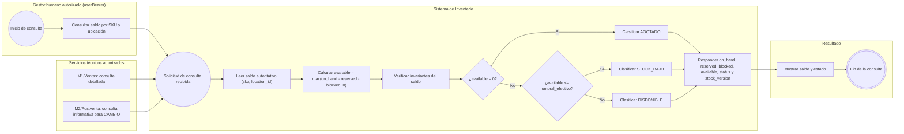

> Este subflujo 4.1 representa la **consulta detallada** por `(sku, location_id)`: la consumen los servicios M1/Ventas (`modulo-ventas`) y M2/Postventa (`modulo-postventa`) con `inventario:disponibilidad:leer` y allowlist por operación, además de usuarios humanos autorizados separados con `userBearer`. M2 consulta de forma informativa para CAMBIO; la lectura no crea reservas ni garantiza disponibilidad futura. Marketplace, Chatbot y Retail mantienen solo sus endpoints comerciales (4.11/4.12) y no acceden al detalle. Ninguna lectura modifica saldos (HU-015 CA-06/CA-49).

### 4.2 Reserva de unidades

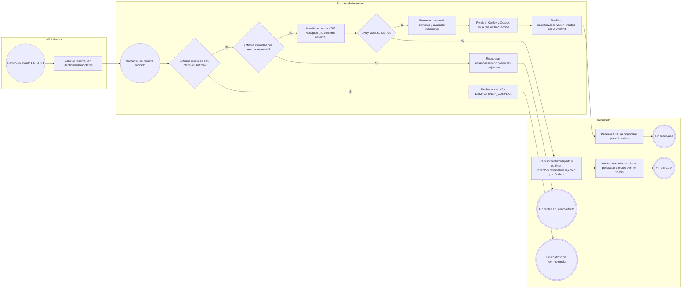

> El resultado `202` es solo admisión. Una reserva **se considera confirmada únicamente** tras `inventory.reservation.created` o lectura de su resultado terminal persistido. Un rechazo por stock insuficiente produce `inventory.reservation.rejected`, con `result_code` tipado y correlación; no incrementa saldos ni registra un Kardex de reserva exitosa. El replay puede recuperar `ACCEPTED` o `PROCESSING`, o un resultado terminal `COMPLETED`/`REJECTED`/`REQUIRES_REVIEW`; nunca presume éxito.

### 4.3 Consumo definitivo y liberación

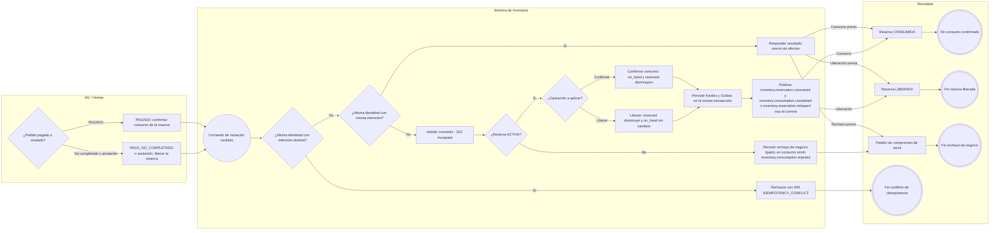

> La ausencia de una reserva `ACTIVA` no convierte un `202` previo en éxito. Ventas espera el resultado final correlacionado y puede recuperar su estado por `operation_id` sin reenviar el comando. `inventory.consumption.rejected` es un evento de rechazo tipado de consumo; no se inventa un evento de rechazo de liberación que no exista en AsyncAPI.

### 4.4 Expiración por TTL y carrera hacia una única terminal

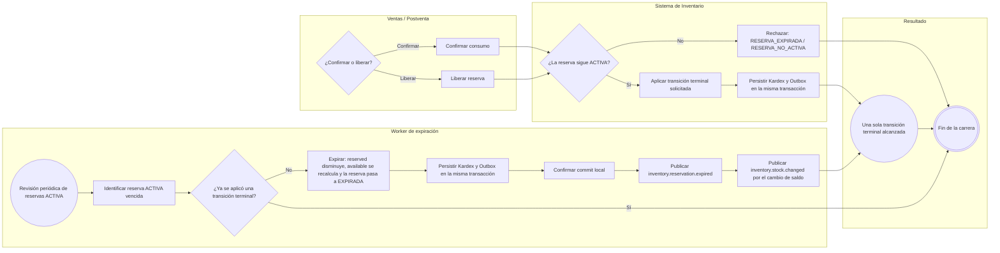

### 4.5 Ajuste absoluto masivo (Bulk)

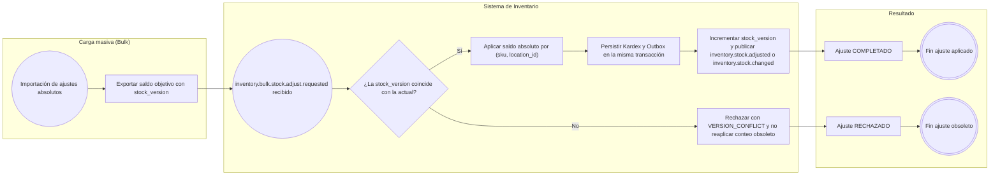

### 4.6 Incidencia física (bloqueo y resolución)

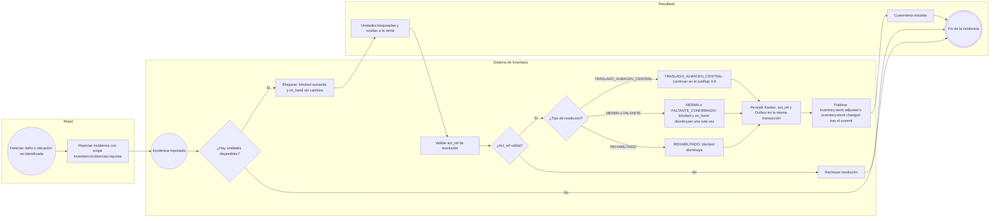

### 4.7 Reintegro F3 por devolución física aceptada

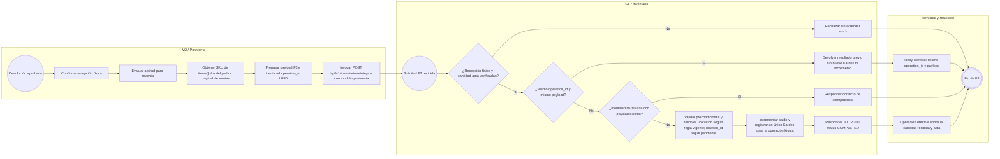

- El payload canónico contiene `operation_id` UUID, `order_id` como referencia textual opaca, `source_ref` (`devolucionId`), `reason: DEVOLUCION_ACEPTADA` y `lines[]` (`sku`, `quantity`, `location_id`). El SKU procede de `items[].sku` del pedido de Ventas, no se infiere desde `productoId`.
- Solo se reintegra cantidad físicamente recibida y apta; cantidades solicitada, recibida, apta y reintegrada se conservan diferenciadas. Un retry idéntico reutiliza identidad y payload. Cada recepción parcial efectiva posterior es una nueva operación con otro `operation_id`.
- M2/Postventa usa `client_credentials`, audiencia `api-productos`, scope `inventario:reintegrar` y `serviceBearer`; su grant efectivo de G7 continúa pendiente. `location_id` es obligatorio en el esquema OpenAPI, pero la ubicación receptora real y la resolución de su valor siguen pendientes; no se inventa un UUID, código ni mapeo.
- M1/Ventas sigue admitido en reintegros por otros motivos contractuales (`ANULACION_POST_CONSUMO`, `RETORNO_LOGISTICO`); no es el invocador de F3.

### 4.8 Venta Retail offline y conciliación

```mermaid
flowchart LR
    subgraph RET["Retail"]
        direction TB
        INICIO((Venta realizada sin conectividad))
        A1["Registrar la venta offline en Ventas/Postventa"]
    end

    subgraph VENT["Ventas / Postventa"]
        direction TB
        A2["Solicitar conciliación offline con scope inventario:conciliar-offline"]
    end

    subgraph INV["Sistema de Inventario"]
        direction TB
        E1(("Conciliación recibida"))
        A4["Resolver internamente tienda → ubicación y validar autorización del actor para la operación y ubicación"]
        D2{"¿Mapeo único y actor autorizado?"}
        D1{"¿Esta identidad estable de venta ya fue conciliada?"}
        D4{"¿Misma intención y payload semántico?"}
        A3["Devolver exactamente el resultado previo COMPLETED o REQUIRES_REVIEW, con cantidades originales y sin nuevos descuentos"]
        A10["Rechazar 409 IDEMPOTENCY_CONFLICT sin modificar saldos ni crear movimientos Kardex"]
        A5["Rechazar la mutación sin cambiar el saldo"]
        A6["Aplicar min(requested, available) con control de concurrencia; excluir reserved y blocked"]
        D3{"¿Hay cantidad efectivamente aplicada?"}
        A7["Registrar el resultado durable de conciliación; no crear movimiento Kardex de cantidad cero"]
        A8["En la misma transacción, registrar resultado, Kardex solo para cantidades aplicadas > 0 y Outbox correspondiente"]
        A9["Publicar el evento de stock correspondiente después del commit"]
    end

    subgraph RES["Resultado"]
        direction TB
        B1["Resultado previo idéntico: estado y cantidades originales"]
        B2["Conciliación COMPLETED"]
        B3["Conciliación REQUIRES_REVIEW con requested, applied y unresolved originales"]
        B4["Rechazo de la mutación según el contrato aplicable"]
        B5["409 IDEMPOTENCY_CONFLICT"]
        FIN_OK(((Fin conciliado)))
        FIN_REV(((Fin con revisión)))
        FIN_REJ(((Fin sin mutación)))
    end

    INICIO --> A1
    A1 --> A2
    A2 --> E1
    E1 --> A4
    A4 --> D2
    D2 -->|"No"| A5
    A5 --> B4
    B4 --> FIN_REJ
    D2 -->|"Sí"| D1
    D1 -->|"Sí"| D4
    D4 -->|"Sí"| A3
    D4 -->|"No"| A10
    A10 --> B5
    B5 --> FIN_REJ
    A3 --> B1
    B1 -->|"COMPLETED"| FIN_OK
    B1 -->|"REQUIRES_REVIEW"| FIN_REV
    D1 -->|"No"| A6
    A6 --> D3
    D3 -->|"No; applied_quantity = 0"| A7
    D3 -->|"Sí"| A8
    A8 --> A9
    A7 -->|"Con faltantes"| B3
    A9 -->|"Sin faltantes"| B2
    A9 -->|"Con faltantes"| B3
    B2 --> FIN_OK
    B3 --> FIN_REV
```

Ventas/Postventa es el invocador contractual vigente en la documentación G6. La alternativa Retail→G6 sigue pendiente de homologación; este diagrama no establece un orden nuevo entre venta, pedido, pago y conciliación. La regla de DEC-F-014 exige resolver tienda→ubicación internamente y autorizar al actor, pero OpenAPI todavía requiere `location_id` en la entrada: esa incompatibilidad contractual no se resuelve aquí ni se inventa un mecanismo de mapeo. La identidad estable de la venta y su deduplicación frente a reintentos técnicos distintos siguen pendientes de homologación; la autorización se valida antes de devolver cualquier resultado previo.

La distinción entre replay de igual intención/payload y conflicto por contenido distinto obedece a DEC-F-009. El mecanismo para identificar establemente una venta offline sigue pendiente de homologación; no se define aquí ninguna clave, fingerprint, índice, campo ni mecanismo de persistencia.

### 4.9 Traslado a almacén central y recepción

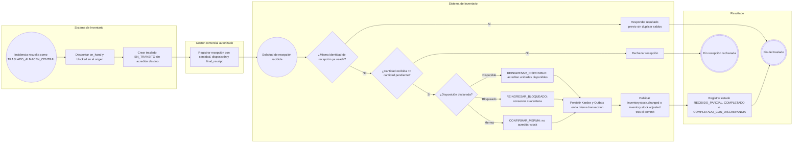

### 4.10 Inicialización de SKU

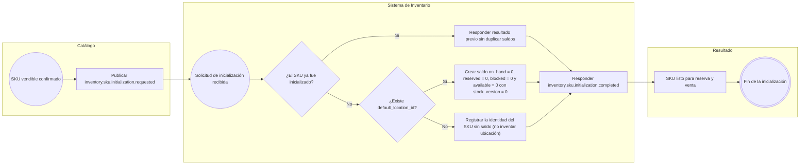

### 4.11 Proyección comercial informativa (GET)

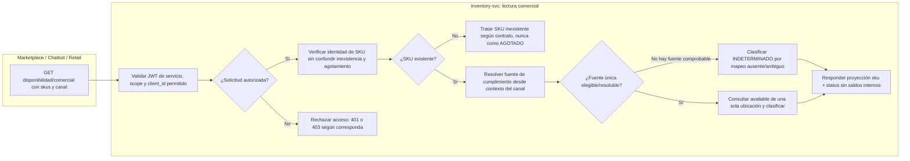

- `GET /api/v1/inventario/disponibilidad/comercial` admite `DISPONIBLE`, `STOCK_BAJO`, `AGOTADO`, `INDETERMINADO`; `AGOTADO` corresponde a SKU existente cuya fuente se conoce y no tiene disponibilidad. Un SKU inexistente no se convierte en `AGOTADO`: se trata conforme al contrato de identidad/errores de la operación.
- La ruta comercial usa el scope `inventario:disponibilidad:leer` **más** la allowlist de clientes técnicos `modulo-marketplace`, `modulo-chatbot`, `modulo-retail`. La disponibilidad detallada admite exactamente M1/Ventas (`modulo-ventas`) y M2/Postventa (`modulo-postventa`) con service JWT, además del acceso humano autorizado independiente. M2 usa el detalle informativamente para CAMBIO; no reserva. No existe consulta de saldos detallados para canales.
- Este GET no recibe necesariamente un contexto `fulfillment` completo. La evaluación depende de una fuente inequívoca resoluble internamente para el canal; si no se puede determinar, se responde `INDETERMINADO`, nunca se inventa un almacén por defecto.

### 4.12 Verificación de cantidad comercial (POST, no vinculante)

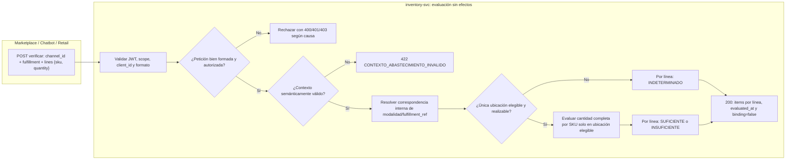

- Entrada del POST candidato: `channel_id` (`MARKETPLACE`, `CHATBOT`, `RETAIL`), `fulfillment` con `mode` y `fulfillment_ref` opaca cuando aplique, y `lines` de 1 a 100 pares `{sku,quantity}`, con cantidades positivas. `GET.status` **no** es `POST.items[].result`: el POST usa `SUFICIENTE`, `INSUFICIENTE` o `INDETERMINADO`.
- El estado `INDETERMINADO` por ausencia, ambigüedad o inviabilidad de un mapeo interno corresponde a **200**, no a `422`; `422 CONTEXTO_ABASTECIMIENTO_INVALIDO` corresponde al contexto *semánticamente inválido*; `400 VALIDACION`, a petición malformada.
- No se agregan cantidades de distintas ubicaciones independientes. Para esta entrega, una sola fuente debe poder atender la cantidad solicitada. Si no se puede demostrar, nunca se responde `SUFICIENTE` por suma arbitraria. El POST no reserva, no modifica Kardex/Outbox y no garantiza disponibilidad futura: `binding=false`.

### 4.13 Recuperación de resultado asíncrono de Inventario

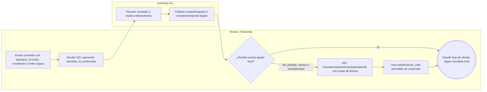

- `GET /api/v1/inventario/operaciones/{operationId}` consulta el resultado persistido, no reenvía el comando. Está reservado a `modulo-ventas` y exige el scope candidato `inventario:operaciones:leer`; su alta/grant en Seguridad (G7) y las pruebas runtime siguen pendientes.
- `order_id` es texto **opaco** de Ventas, mientras `operation_id` y `reservation_id` tienen formato UUID. Los eventos relevantes incluyen, según operación, `inventory.reservation.created`, `inventory.reservation.rejected`, `inventory.consumption.completed` e `inventory.consumption.rejected`. El consumidor verifica correlación y procesa de forma idempotente; un retraso no transforma la admisión en éxito.
- El diagrama expresa una recuperación conceptual: si la operación sigue `ACCEPTED` o `PROCESSING`, Ventas no debe marcar éxito y sigue la política de consulta/espera prevista; no se presume que cada GET devuelva una terminal. La documentación de este flujo no acredita implementación ni pruebas E2E.

---

## 5. Notas generales

- **Actor humano:** el usuario del backoffice en este flujo es el `GESTOR_COMERCIAL`; la granularidad de inventario se expresa mediante capacidades locales asociadas a su `sub`, no mediante un rol global independiente.
- **Idempotencia:** repetir un comando con la misma identidad y la misma intención responde el resultado previo sin efectos secundarios; reutilizar la identidad con otra intención produce `409 IDEMPOTENCY_CONFLICT` (HU-015 CA-14, SPEC-015 §30). Para una venta offline, la identidad estable debe impedir un segundo descuento aunque cambie la identidad técnica del reintento; su campo/mecanismo y el ámbito de unicidad siguen pendientes, por lo que no se consideran implementados.
- **202 Accepted:** es solo admisión. El éxito/rechazo de reserva y consumo se confirma por **resultado durable** y evento tipado; tras pérdida del evento, Ventas recupera con `GET /api/v1/inventario/operaciones/{operationId}` sin reejecución. `operation_id`/`reservation_id` son UUID; `order_id` es texto opaco de Ventas; se preservan `correlation_id` y `causation_id` según AsyncAPI v2 (HU-015 CA-50/CA-51 y ADR B1).
- **Kardex y Outbox:** toda mutación autoritativa registra Kardex con saldos anterior/posterior, operación, SKU y ubicación, y persiste el Outbox en la misma transacción local; la publicación de eventos ocurre después del commit (HU-015 CA-16/CA-19, SPEC-015 §27).
- **Invariantes:** en toda operación se cumple `on_hand >= 0`, `reserved >= 0`, `blocked >= 0`, `reserved + blocked <= on_hand` y `available = max(on_hand - reserved - blocked, 0)` con `available >= 0` (HU-015 CA-04, SPEC-015 §13).
- **Concurrencia:** confirmar, liberar y expirar la misma reserva produce una única transición terminal; dos operaciones concurrentes nunca comprometen las mismas unidades disponibles (HU-015 CA-13/CA-15).
- **Consultas:** 4.1 es el saldo detallado autorizado; 4.11 y 4.12 son consultas comerciales limitadas y sin efectos. Todas son solo lectura. La política D-INV-01 está **adoptada**, pero no se considera implementada/validada; el contrato comercial continúa `provisional` por pruebas runtime pendientes (HU-015 CA-43 a CA-49).
- **Seguridad por operación:** `inventario:disponibilidad:leer` por sí solo no habilita rutas. JWT de servicio de `modulo-ventas` y `modulo-postventa` pueden leer el detalle sujeto a scope y allowlist; la lectura de M2 es informativa para CAMBIO. Los JWT de `modulo-marketplace`, `modulo-chatbot` y `modulo-retail` solo acceden a sus rutas comerciales. M2 no tiene autorización acordada para reservar, consumir, liberar, conciliar offline ni consultar operaciones. La consulta de resultado de operación sigue exclusiva de M1 y requiere el nuevo permiso `inventario:operaciones:leer` aún pendiente de registro y grant por G7.
- **No confundir estados:** `GET.status` es `DISPONIBLE/STOCK_BAJO/AGOTADO/INDETERMINADO`; `POST.items[].result` es `SUFICIENTE/INSUFICIENTE/INDETERMINADO`. La ambigüedad de mapeo no equivale a agotamiento ni a contexto semánticamente inválido.

### Contratos de referencia

| Endpoint (baseline `0.5.0` y/o candidato `0.6.0-rc.1`) | Subflujo |
|---|---|
| `GET /api/v1/inventario/disponibilidad` | 4.1 — Consulta detallada autorizada (baseline) |
| `GET /api/v1/inventario/disponibilidad/comercial` | 4.11 — Proyección comercial informativa (ruta candidata) |
| `POST /api/v1/inventario/disponibilidad/comercial/verificar` | 4.12 — Verificación de cantidades no vinculante (ruta candidata) |
| `GET /api/v1/inventario/operaciones/{operationId}` | 4.13 — Recuperación persistida para Ventas (ruta candidata; grant G7 pendiente) |
| `POST /api/v1/inventario/reservas` | 4.2 — Reserva de unidades |
| `POST /api/v1/inventario/reservas/{reservaId}/confirmar` | 4.3 — Consumo definitivo |
| `POST /api/v1/inventario/reservas/{reservaId}/liberar` | 4.3 — Liberación |
| `POST /api/v1/inventario/incidencias` | 4.6 — Reportar incidencia |
| `POST /api/v1/inventario/incidencias/{incidenciaId}/resolver` | 4.6 — Resolución (incluye traslado) |
| `POST /api/v1/inventario/reintegros` | 4.7 — Reintegro |
| `POST /api/v1/inventario/conciliaciones-offline` | 4.8 — Venta offline |
| `GET /api/v1/inventario/traslados` | 4.9 — Consulta de traslados |
| `POST /api/v1/inventario/traslados/{trasladoId}/recepciones` | 4.9 — Recepción de traslado |

Los eventos publicados corresponden al catálogo de AsyncAPI (`inventory.reservation.*`, `inventory.consumption.*`, `inventory.stock.changed`, `inventory.stock.adjusted`, `inventory.bulk.stock.adjust.*`, `inventory.sku.initialization.*`), con `inventory.reservation.rejected` e `inventory.consumption.rejected` tipados en el candidato. AsyncAPI `0.6.0-rc.1` declara **40 canales y 40 mensajes**; la línea base histórica tenía 39. Publicación contractual no equivale a despliegue ni a aprobación de pruebas.

---

<!-- HOMOLOGACION-HTTP-0.5.0:START -->
## Flujos de lectura — baseline 0.5.0 y extensión candidata 0.6.0-rc.1

La línea base `0.5.0` se conserva como referencia histórica. Los contratos HTTP y asíncronos del PR #86 son candidatos `0.6.0-rc.1`; los subflujos comerciales y la lectura de resultados siguen provisionales hasta validación de implementación, grants y E2E. La adopción de D-INV-01 **no significa** que esos controles estén ya desplegados.

### Consulta detallada

```text
GESTOR_COMERCIAL autorizado o modulo-ventas con JWT de servicio + allowlist
→ GET /api/v1/inventario/disponibilidad
→ leer saldo autoritativo (sku, location_id) sin agregar ubicaciones
→ calcular available, validar invariantes y determinar status
→ devolver on_hand/reserved/blocked/available/status/stock_version
```

`modulo-marketplace`, `modulo-chatbot` y `modulo-retail` no tienen acceso a esa lectura detallada. Para los JWT técnicos de M1/Ventas y M2/Postventa, además del cliente autorizado, se verifica `inventario:disponibilidad:leer`; la ruta permite también acceso humano debidamente autorizado con `userBearer`. El acceso de M2 es informativo para CAMBIO y no garantiza stock futuro ni reserva unidades.

### Proyección comercial GET

```text
Marketplace / Chatbot / Retail (JWT técnico + scope + allowlist)
→ GET /api/v1/inventario/disponibilidad/comercial?skus=...&canal=...
→ validar SKU y resolver internamente una fuente de cumplimiento única y elegible
→ si no se puede resolver, status=INDETERMINADO
→ si se resuelve, evaluar available de esa ubicación y clasificar status
→ devolver sku + status, sin ubicación, cantidades, umbral ni stock_version
```

`AGOTADO` solo representa SKU **existente** con fuente evaluable sin disponibilidad; la consulta nunca efectúa una reserva.

### Verificación comercial POST por cantidad

```text
Marketplace / Chatbot / Retail (JWT técnico + scope + allowlist)
→ POST /api/v1/inventario/disponibilidad/comercial/verificar
→ validar channel_id, fulfillment {mode, fulfillment_ref?}, lines {sku,quantity}
→ contexto semánticamente inválido: 422 CONTEXTO_ABASTECIMIENTO_INVALIDO
→ request malformado: 400 VALIDACION
→ mapeo interno ausente/ambiguo: 200, item.result=INDETERMINADO
→ mapeo único ejecutable: evaluar la cantidad completa en la fuente elegible
→ 200, items[].result=SUFICIENTE/INSUFICIENTE/INDETERMINADO; binding=false
```

D-INV-01 está **adoptada**: se resuelve una sola ubicación elegible por contexto de cumplimiento, sin sumar saldos de fuentes independientes. Si no puede probarse ese cumplimiento, se responde `INDETERMINADO`, no `AGOTADO` ni `SUFICIENTE`. Una futura agregación multi-origen necesita otra ADR y capacidad demostrable.

### Recuperación de operación de Inventario

```text
Ventas admite un 202 para reserva/consumo/liberación
→ espera evento final tipado (resultado exitoso o rechazo)
→ si falta o se retrasa: GET /api/v1/inventario/operaciones/{operationId}
→ inventory-svc devuelve estado/resultado persistido sin reejecutar
→ Ventas decide solo cuando el resultado confirma éxito o rechazo
```

La recuperación se limita a `modulo-ventas`, con scope candidato `inventario:operaciones:leer`, cuyo registro/grant por G7 permanece pendiente. Las tres consultas de disponibilidad (detalle, GET comercial y POST comercial) son de solo lectura; **ninguna** altera saldo, Kardex ni reservas.
<!-- HOMOLOGACION-HTTP-0.5.0:END -->
